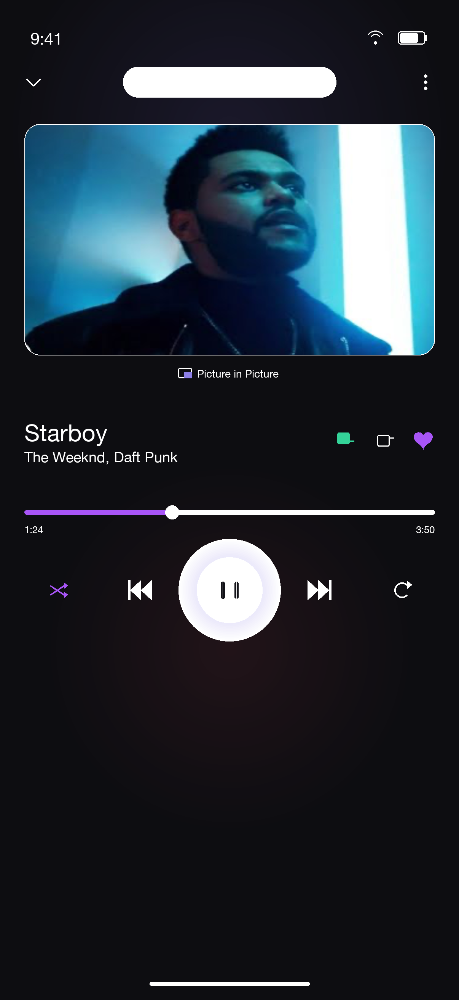
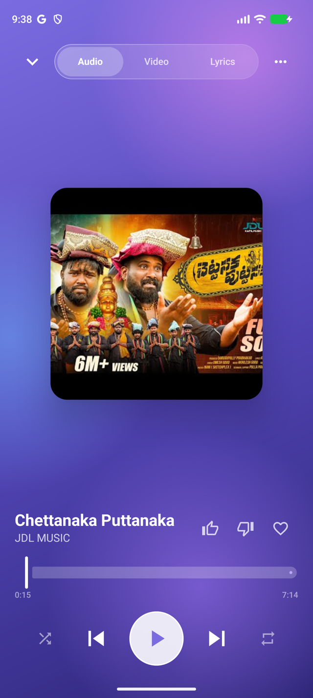
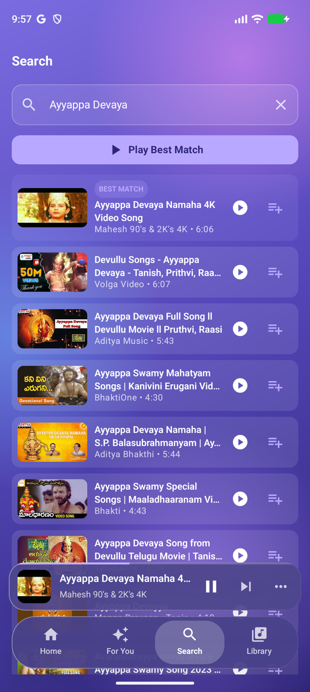
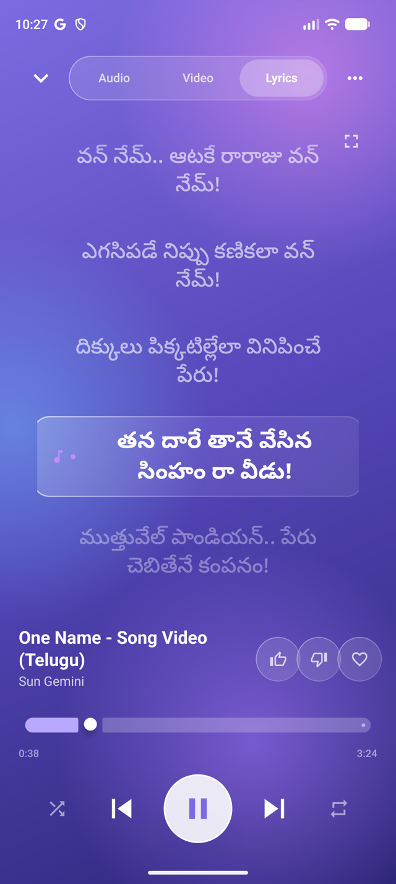
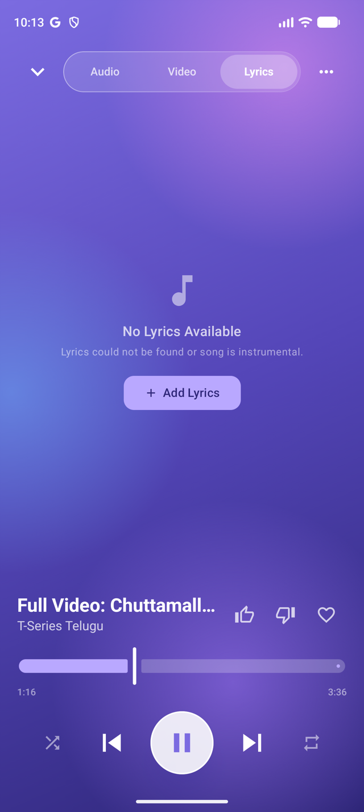
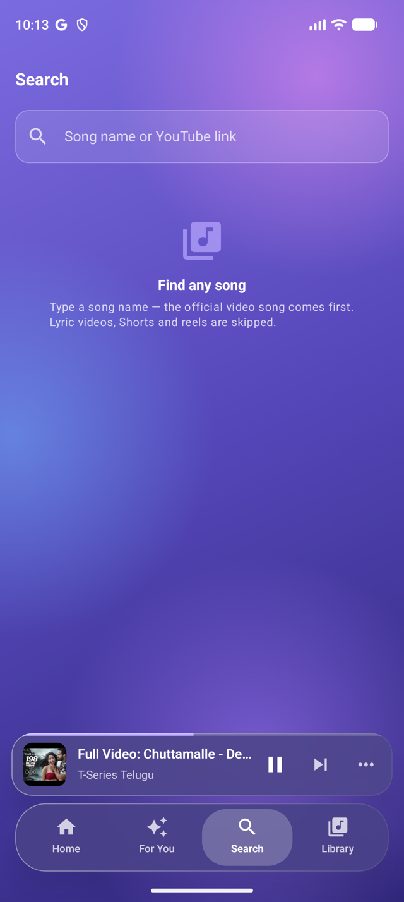
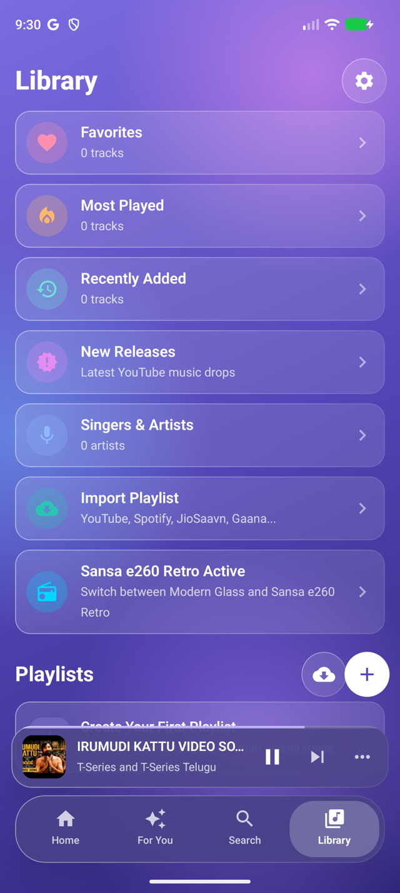
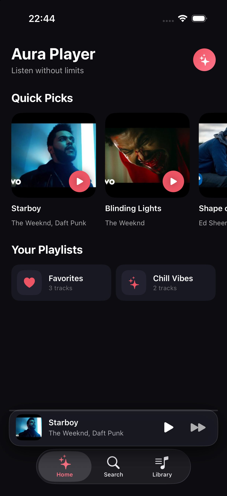
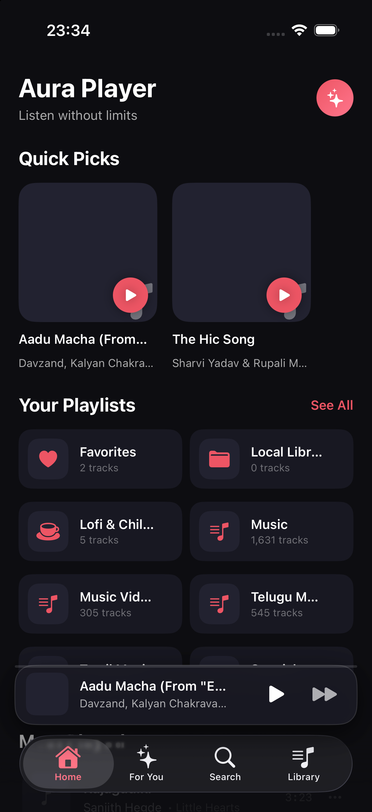
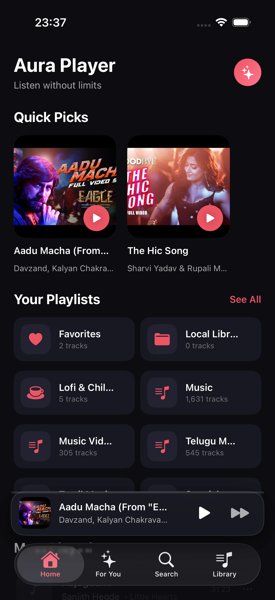

# 🎵 Aura Player

<p align="center">
  
</p>

<p align="center">
  <b>A dark, glassy music player for iPhone, Mac and Android.</b><br/>
  Plays your songs from YouTube, shows synced lyrics you can write yourself, and keeps your library in step across your devices.
</p>

<p align="center">
  
  
  
  
</p>

<p align="center">
  <a href="https://amara-manikanta.github.io/Aura-Player/"><b>🌐 Website & Android APK</b></a> •
  <a href="https://amara-manikanta.github.io/Aura-Player/AuraPlayer.apk"><b>⬇️ Direct APK link</b></a>
</p>

---

## 📸 Screenshots

### 📱 Android Experience (Jetpack Compose & Material 3)

<p align="center">
  
  
  
</p>

<p align="center">
  
  
  
</p>

### 🍏 iOS Experience (SwiftUI & Liquid Glass)

<p align="center">
  
  
  
</p>

<p align="center">
  
  
</p>

---

## ✨ Features

### Playing music
- **Audio, Video and Lyrics views** for every song. Switch without losing your place.
- **Background playback and lock-screen controls** on iPhone (Now Playing info, play/pause/next/previous).
- **Full-screen video** with fit/fill, auto-hiding controls and 👍 / 👎 buttons.
- **Right / wrong video feedback.** 👍 pins the video for a song; 👎 skips to the next best match and never picks that one again.
- **Change Video Link** for any song, saved to every copy of it.
- **Start and end times** per song, to skip intros and outros.
- **Resume where you left off.** The last song and position survive a restart.
- **Rename a song** (title and artist) from the player menu, applied to every copy.
- **Copy song name** from the player menu.

### Lyrics
- **Synced lyrics** that highlight the current line and scroll along, shown centered. In the Video view they appear below the video.
- **Write or fix lyrics yourself** (iPhone and Mac): type or paste the lyrics, then play the song and tap as each line starts to time it. Pasted `[mm:ss.xx]` lyrics (LRC) keep their times.
- **Copy lyrics with their times** and paste them into another song.
- Lines you didn't time still follow along: they get a time between their neighbours.

### Library
- **Playlists:** create, rename, merge and delete; add songs by name or by YouTube link; search inside a playlist.
- **Favorites, Most Played, Recently Added, New Releases and Artists** collections.
- **For You** tab with recommendations.
- **Apple Music import** (play counts, recently added songs) on iPhone and Mac.
- **Backup and restore** the library through the Files app.

### Sharing and syncing
- **Share a song or playlist** as a WhatsApp message with a link. Opening the link shows the songs and an "Open in Aura Player" button.
- **Import a shared playlist** by opening the link, or on iPhone by copying the message and tapping the import button in Library. Android has an Import Playlist dialog.
- **Mac ↔ iPhone sync over Wi-Fi.** Compares both libraries and merges them instead of copying one over the other: play counts add up, newer edits win, and nothing is deleted without a trace (the Mac keeps backups). Devices pair with a code.

### Look
- **Liquid-glass interface** on all three apps.
- **Full rotation support** across vertical (portrait) and horizontal (landscape) orientations on iOS and Android.

---

## 📲 Android Installation (Direct APK)

AuraPlayer is distributed directly as an APK to provide seamless high-definition streaming, background playback, and custom synced lyrics without app store constraints.

### Step-by-Step Guide:

1. **Download the APK**:
   - Download the latest **[`AuraPlayer.apk`](https://amara-manikanta.github.io/Aura-Player/AuraPlayer.apk)** directly, or grab it from the [Releases](https://github.com/Amara-Manikanta/Aura-Player/releases) tab.
   - If Chrome or your browser displays *"File might be harmful"*, tap **Download anyway** (this is standard on Android for any app downloaded outside the Play Store).

2. **Open the Downloaded APK**:
   - Once the download is complete, pull down your notification shade and tap **AuraPlayer.apk**.
   - Alternatively, open your phone's **Files** or **Downloads** app and tap **AuraPlayer.apk**.

3. **Allow "Install Unknown Apps" (First-time only)**:
   - If prompted: *"For your security, your phone is not allowed to install unknown apps from this source"*, tap **Settings**.
   - Turn **ON** the switch for **"Allow from this source"** (for Chrome or Files).
   - Tap the **Back** button on your phone to return to the installer.

4. **Install & Launch**:
   - Tap **Install** (or **Update** if updating an existing version).
   - Once completed, tap **Open** to launch Aura Player!

> [!TIP]
> **Updating in the future**: Whenever a new update is released, simply download the new APK and tap **Install**. Android will update the app in-place while safely preserving all your custom playlists, favorites, and synced lyrics.

---

## 🗂️ Repository layout

```
Aura-Player/
├── ios/        iPhone app (SwiftUI, iOS 17+)
├── macos/      Mac app (SwiftUI, macOS 14+, built with Swift Package Manager)
├── android/    Android app (Kotlin, Jetpack Compose, Media3, minSdk 26)
├── shared/     Code shared by the Apple apps (the sync protocol)
└── docs/       Website, APK download and the share-link page (GitHub Pages)
```

| | iPhone | Mac | Android |
|---|---|---|---|
| Playback | YouTube player in a web view | Audio through AVPlayer (stream found with `yt-dlp`); video through a web view | Media3 and YouTube |
| Custom lyrics editor | ✅ | ✅ | ✅ |
| Audio / Video / Synced Lyrics modes | ✅ | ✅ | ✅ |
| Mac ↔ iPhone sync | ✅ | ✅ | – |
| Share links | ✅ | ✅ | ✅ |
| Import shared links | ✅ | not yet | ✅ |

---

## 🚀 Building

### iPhone
```bash
cd ios
open AuraPlayerIOS.xcodeproj
```
Pick your iPhone or a simulator and press Run (⌘R). Running on a real iPhone needs your Apple ID set under Signing & Capabilities. With a free Apple ID the install expires after a few days and has to be reinstalled.

### Mac
```bash
brew install yt-dlp ffmpeg     # used to find audio streams
cd macos
./build_app.sh                 # builds AuraPlayer.app
open AuraPlayer.app
```
For development, `swift build` is enough.

### Android
```bash
cd android
./gradlew assembleDebug
```
The APK is written to `android/app/build/outputs/apk/debug/`.

---

## 🔄 Syncing a Mac and an iPhone

1. Open the Mac app and choose **Sync with iPhone** in the sidebar. It shows a pairing code.
2. On the iPhone, open **Settings → Sync with Mac**, allow Local Network access, and enter the code.
3. Both devices must be on the same Wi-Fi. After the first pairing the iPhone syncs when you open the app.

---

## ⚠️ Good to know

- **YouTube limits.** The Mac app asks YouTube for audio streams through `yt-dlp`. If you skip through many songs quickly, YouTube can answer "Sign in to confirm you're not a bot" for a while. Video view keeps working because it uses YouTube's embedded player.
- **Songs come from YouTube,** so a song can occasionally match the wrong video. Use 👎 or Change Video Link to fix it.
- **Offline downloads** are not supported.

---

## 📄 License

MIT. See [LICENSE](LICENSE).

---

## ⚖️ Disclaimer

Aura Player is an independent open-source project and is not affiliated with, endorsed by, sponsored by, or associated with Google LLC, YouTube, Spotify, Gaana, JioSaavn, Apple Inc., or SanDisk. All product names, logos, and brands are property of their respective owners. Aura Player does not store or distribute copyrighted media files.

