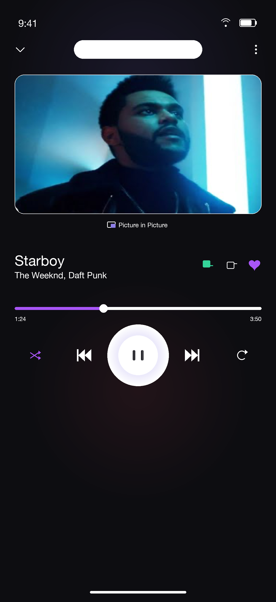
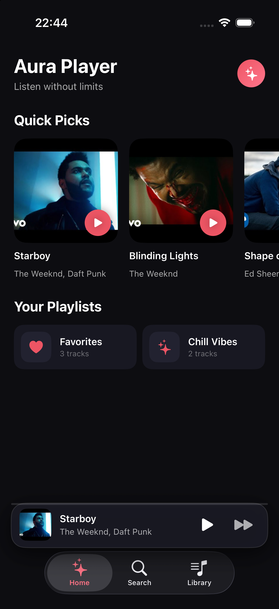
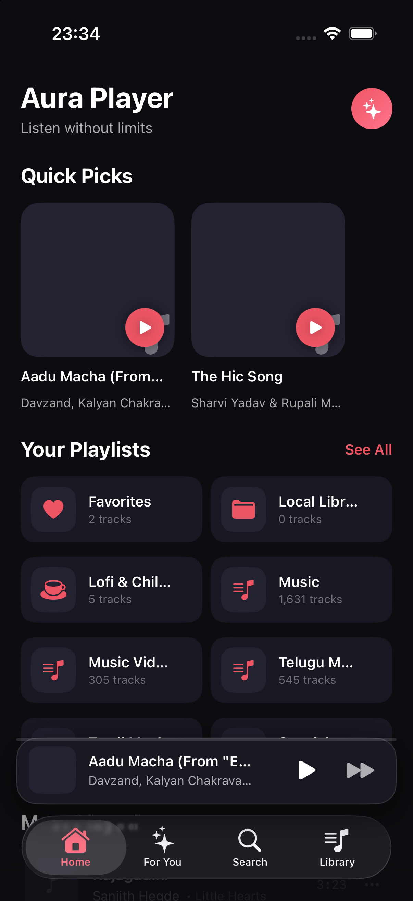
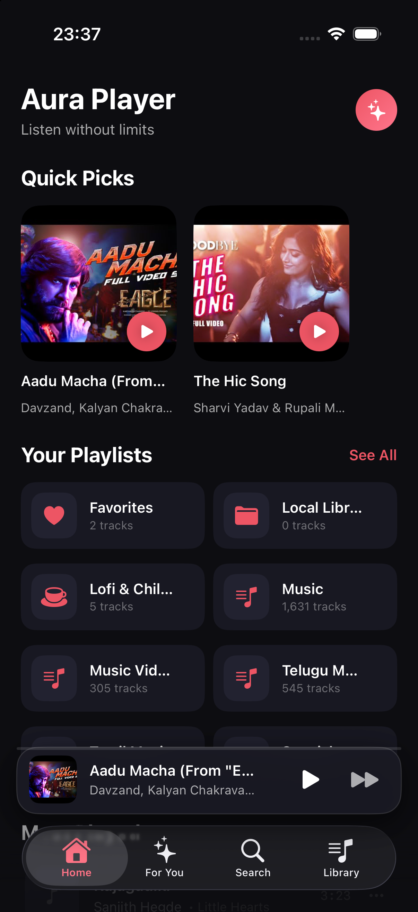

# 🎵 Aura Player

<p align="center">
  
</p>

<p align="center">
  <b>A sleek, AMOLED dark-themed music streaming ecosystem for iOS, macOS, and Android.</b><br/>
  Seamlessly combines YouTube streaming, synchronized karaoke lyrics, real-time audio visualization, and intelligent recommendation algorithms.
</p>

<p align="center">
  
  
  
  
</p>

<p align="center">
  <a href="https://amara-manikanta.github.io/Aura-Player/"><b>🌐 Official Website & Direct APK Download</b></a> •
  <a href="https://amara-manikanta.github.io/Aura-Player/AuraPlayer.apk"><b>⬇️ Direct APK Link (25 MB)</b></a>
</p>

---

## 📸 Screenshots Showcase

<p align="center">
  
  
  
</p>

<p align="center">
  
  
</p>

---

## 🌟 Key Highlights

### 🎨 Dual Theme Engine: Modern AMOLED & Sansa e260 Retro
- **Modern AMOLED Theme**: Built with a true black `#0D0D11` background and warm ambient gradients designed specifically for Super Retina displays, featuring the signature **Echo Coral** (`#ED5564`) primary theme with glowing frosted glass controls.
- **SanDisk Sansa e260 Retro Theme**: Transforms the Now Playing player into an authentic 2000s SanDisk Sansa e260 MP3 player featuring:
  - Brushed titanium/gunmetal metallic chassis with chamfered highlights.
  - Glossy LCD color display with live retro 8-band graphic equalizer spectrum bars.
  - The iconic **Interactive Virtual Rotator (Scroll Wheel)** with its **glowing electric neon blue ring** (`#00D4FF`), full circular touch-drag gesture tracking, and mechanical tactile haptic clicks (`Haptics.light()`) for time scrubbing and volume adjustment!
  - Physical-style hardware buttons (`|<<`, `▶ ||`, `>>|`, `MENU`, `VOL/SCRUB`, `FAV`).
  - Configurable in the new **Settings & Themes** menu.

### 🎧 Unified Triple-Mode Player
- **Audio Mode**: Displays high-res album artwork with a reactive audio visualizer.
- **Video Mode**: Inline HD YouTube music video playback.
- **Lyrics Mode**: Real-time synchronized karaoke lyrics with smooth auto-scroll.

### 📱 Background Playback & Lock Screen
- Continues playing in the background when the app is minimized or the screen is locked.
- Full `MPNowPlayingInfoCenter` and `MPRemoteCommandCenter` integration (Artwork, Scrubber, Play/Pause/Skip) for Lock Screen and Dynamic Island / Control Center.

### 📚 17 Playlists & 3,432 Bundled Tracks
- Full cross-platform library preloaded into the application bundle with zero first-run setup required.
- **Playlist Management**: Rename, delete, merge playlists, and remove individual tracks.
- **Change Video Link**: Easily paste a custom YouTube link or search alternative official videos directly inside the Now Playing sheet.
- **Audio Trimming**: Set custom start and end timestamps (`startTime`, `endTime`) for intro/outro skipping.

### 💾 Backup & File Sharing (`On My iPhone → Aura Player`)
- Direct integration with the native iOS **Files** app (`UIFileSharingEnabled`).
- 1-tap **Export Library Backup** via `ShareLink` (AirDrop, iCloud Drive, Files).
- 1-tap **Import Backup** and **Reset to Default Library**.

---

## 🗂️ Monorepo Architecture

```
Aura-Player/
├── ios/                    # Native iOS App (SwiftUI, iOS 17+, iPhone 14 Pro / 15 / 16)
│   ├── AuraPlayerIOS/      # App sources, Models, Views, Services
│   │   ├── Assets.xcassets # 1024x1024 App Icon & Accent Color
│   │   ├── Resources/      # Bundled library (17 playlists, 3,432 tracks)
│   │   ├── Models/         # MediaTrack, Playlist
│   │   ├── Services/       # PlaybackManager, YouTubeService, LyricsService, etc.
│   │   └── Views/          # SwiftUI screens and player components
│   └── AuraPlayerIOS.xcodeproj
│
├── macos/                  # Native macOS App (SwiftUI, AppKit, AVPlayer, yt-dlp)
│   ├── Sources/AuraPlayer/ # Desktop views, Sidebar, MiniPlayer, Visualizer
│   ├── Resources/          # macOS AppIcon.icns, assets
│   └── Package.swift       # Swift Package Manager project definition
│
├── android/                # Native Android App (Kotlin, Jetpack Compose, Material 3)
│   ├── app/src/main/       # Compose UI, Media3 ExoPlayer, Architecture components
│   └── build.gradle.kts
│
└── screenshots/            # Hi-res UI screenshots showcase
```

---

## 🚀 Building & Running

### 📱 iOS
```bash
cd ios
open AuraPlayerIOS.xcodeproj
# Select your target device (e.g., iPhone 14 Pro / iPhone 15) and press Run (⌘R)
```

### 💻 macOS
```bash
cd macos
swift build
./build_app.sh
```

### 🤖 Android
```bash
cd android
./gradlew assembleDebug
# Deploy to connected device or emulator via Android Studio
```

---

## 📄 License
This project is licensed under the MIT License — see the [LICENSE](LICENSE) file for details.
